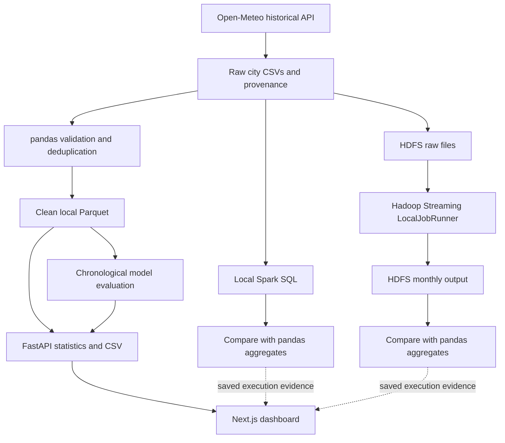

# Weather Data Analysis — lifecycle and tool coverage

**The project implements a complete local batch path from a real source to an analytical application. It does not implement the entire production data engineering lifecycle.** This assessment is based on the repository and executed evidence on 8 October 2026. A working core pipeline, a production platform and completion of every syllabus laboratory are different scopes.

## Are the tools enough?

For a weather-analysis CBP that expects collection, cleaning, Hadoop concepts, processing, analysis and visualization, the current stack provides substantial executable evidence. The exact marking rubric still determines acceptance. The supplied 22PC1CS401 syllabus also contains Hive, Pig, Sqoop, HBase, ZooKeeper, Mahout and separate word-count/property/log/K-means exercises; these are not all implemented. See [the syllabus mapping](SYLLABUS.md).

Adding more product names would not by itself close the lifecycle gaps below. The five-year, ten-city archive fits on this Mac. Hadoop and Spark demonstrate real processing frameworks and independent result checks; this workload does not demonstrate distributed speedup or production scale.

| Tool | Actual role here | Why it is useful / scope |
|---|---|---|
| Open-Meteo API + Python requests | Fetch attributed ERA5 hourly history; preserve request metadata and raw hashes | Real ingestion, bounded retries and reproducibility |
| pandas + PyArrow/Parquet | Validate, deduplicate, aggregate and store the dataset used by the API | Main serving path and independent numerical reference |
| HDFS | Store raw CSVs and Hadoop result files in one NameNode/one DataNode namespace | Actual filesystem metadata, blocks and client/data-node interaction; replication factor one |
| Hadoop Streaming MapReduce | Execute Python mapper/shuffle/reducer through Hadoop, reading and writing HDFS | Actual Hadoop batch computation via LocalJobRunner; no YARN scheduling |
| Spark SQL | Independently process the raw local CSV files and compare monthly aggregates | Actual local Spark computation; this job does not read HDFS |
| scikit-learn | Evaluate temperature prediction using past-only features and a chronological holdout | Model error and persistence baseline; historical evaluation, not a forecast service |
| FastAPI + Next.js/TypeScript | Serve analytics, filtered CSV and interactive explanations locally | Usable delivery of the data product |
| pytest + checksums + execution logs | Check calculations, failure behavior and association of evidence with the dataset | Verification and reproducibility; not an operational monitoring platform |

## The actual data paths

Hadoop and Spark are independent processing/verification branches. Ordinary weather charts are computed from local Parquet through pandas/FastAPI. The diagram does not imply that Spark consumes Hadoop results or that every dashboard request launches Hadoop. The Explorer's live HDFS inspection and recorded-job teaching replay are also distinct.

## Lifecycle coverage

“Implemented” below describes the stated local batch capability. “Partial” means useful foundations exist but operational requirements remain. There is no universal completion percentage that can be inferred from the number of installed tools.

| Stage | Status | Evidence in this project | Remaining work |
|---|---|---|---|
| Requirements and source discovery | Implemented for this CBP | Weather problem statement, field units, ten cities, dates, ERA5 interpretation and syllabus mapping | Stakeholder acceptance criteria, refresh/freshness targets and measurable service objectives |
| Batch ingestion | Implemented | `backend/ingest.py`: API extraction, four attempts with backoff, checksum/date cache, temporary CSV replacement, provenance and failure report | Automatic scheduling, watermarks, incremental merges, late-arriving corrections and managed backfills |
| Validation and transformation | Implemented, with limited gates | Range checks, invalid/missing counts, deduplication, summaries and Parquet; analytical tests | Schema evolution, rejected-record quarantine and a publication gate requiring complete expected city/hour coverage |
| Storage and data organization | Implemented locally | Raw CSV/provenance, compressed Parquet, actual HDFS input/output | Partition strategy at scale, retention tiers and automatic lifecycle policies |
| Batch processing | Implemented locally | pandas, real Spark SQL and real Hadoop Streaming; independent aggregate parity | Distributed workers, resource scheduling, load/performance testing and failure recovery |
| Analytics and model evaluation | Implemented for the historical archive | Statistics, correlations, extremes, chronological model holdout and baseline | Drift monitoring, retraining policy and operational forecast validation if forecasting becomes a product |
| Serving and consumption | Implemented locally | Read-only API, Next.js dashboard, date/city filters and CSV export | Multi-user deployment, API versioning, concurrency targets and access management |
| Orchestration and reproducible operations | Partial | Explicit CLI modules, setup/start/stop scripts, cache-aware ingestion and saved evidence | A workflow-wide dependency runner, persisted run history, resumable steps, scheduling and managed backfills |
| Observability and quality operations | Partial | Health route, processing counts, job logs, parity checks and HDFS inspection | Freshness/completeness alerts, metric history, incident handling and automated remediation |
| Governance, lineage and security | Partial | Attribution, source URLs/parameters, timestamps, hashes, local-only listeners and documented dataflow | Automated catalog/lineage, role-based access, policy enforcement and audited multi-user access |
| Retention, backup and recovery | Not operationalized | Raw sources retained and HDFS namespace survives a normal restart | Defined retention/deletion policy, independent backups and a verified restore/disaster-recovery exercise |

Normal restart success is not a backup/restore test. Replication factor one on a single Mac provides no independent replica if that machine or disk fails. Historical row replay is not a live streaming ingestion service. The Windows/macOS CI definition is present, but a definition alone does not prove those CI runs occurred; actual Windows runtime execution remains unverified.

## Highest-value next improvements

1. Add one ordered batch runner with a persisted run manifest, clear failure reporting and completeness/quality checks before publishing a new dataset.
2. Add incremental date-window ingestion and safe merge/backfill behavior, including tests for reruns and late corrections.
3. Add freshness and coverage monitoring, followed by a documented backup and a real restore test.
4. Add Hive or YARN when the assignment explicitly requires those capabilities. Add shared-service authentication and access controls if the app is deployed for other users.

These are future improvements, not features completed by the visualization request. The current project can demonstrate the batch path and explain its limits without claiming to be a complete production platform.

## Reference basis

The lifecycle assessment above comes from this repository. Broader operational expectations are consistent with [AWS data engineering guidance](https://docs.aws.amazon.com/prescriptive-guidance/latest/aws-caf-platform-perspective/data-eng.html), which discusses ingestion, quality, serving, automation and operations, and its [orchestration guide](https://aws.amazon.com/what-is/data-orchestration/). These sources describe capabilities, not a requirement to adopt AWS.

The Explorer's architecture explanations use the [Apache HDFS architecture](https://hadoop.apache.org/docs/r3.5.0/hadoop-project-dist/hadoop-hdfs/HdfsDesign.html), [MapReduce tutorial](https://hadoop.apache.org/docs/r3.5.0/hadoop-mapreduce-client/hadoop-mapreduce-client-core/MapReduceTutorial.html) and [WebHDFS interface](https://hadoop.apache.org/docs/r3.5.0/hadoop-project-dist/hadoop-hdfs/WebHDFS.html). The NameNode manages metadata; file bytes travel between clients and DataNodes.
